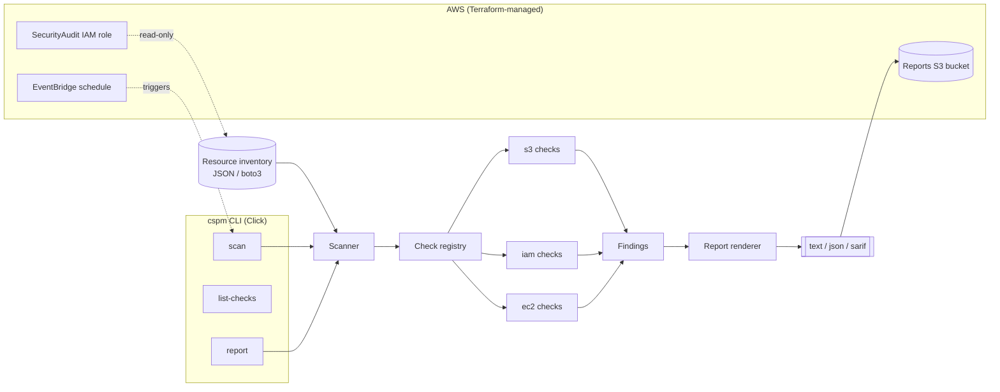

# Cloud Security Posture Management (CSPM)

Scan cloud accounts for misconfigurations against CIS benchmark controls,
produce severity-ranked findings, and report them as text, JSON, or SARIF.

[](LICENSE)
[](https://github.com/abhisheksawant52/cloud-security-posture-management/actions/workflows/ci.yml)
[](https://www.python.org/)
[](https://www.terraform.io/)

## Overview

CSPM is a command-line tool and pluggable check framework that audits an AWS
account against a subset of the CIS AWS Foundations Benchmark. It evaluates a
**resource inventory** — a plain mapping of service name to resource records —
and emits findings that carry a control id, CIS reference, severity, the
affected resource, a pass/fail status, and remediation guidance.

The scanner is deliberately decoupled from the AWS SDK. In production the
inventory is collected from a `boto3` session assuming a read-only auditing
role; in tests (and for offline analysis) the same inventory can be injected
directly from JSON. This keeps every control's logic deterministic and
verifiable without network or cloud credentials.

The repository also ships the Terraform needed to deploy the auditing footprint:
a read-only IAM role (the AWS-managed `SecurityAudit` policy), an encrypted S3
bucket for reports, and an optional EventBridge schedule for recurring scans.

## Architecture



Components:

- **CLI** (`cspm.cli`) — Click app exposing `scan`, `list-checks`, `report`.
- **Scanner** (`cspm.scanner`) — runs registered checks over an inventory.
- **Check registry** (`cspm.registry`) — decorator-based plugin registration.
- **Checks** (`cspm.checks.*`) — S3, IAM, and EC2 CIS controls.
- **Models** (`cspm.models`) — `Control`, `Finding`, `ScanResult`, severities.
- **Report** (`cspm.report`) — text, JSON, and SARIF 2.1.0 renderers.
- **Terraform** (`terraform/`) — audit role, reports bucket, scan schedule.

## Features

- Pluggable check framework — add a control by decorating a function.
- CIS-mapped checks for S3 (public access, encryption, versioning), IAM (root
  MFA, password policy, unused access keys), and EC2 (open security groups).
- Severity ranking (critical/high/medium/low) with a configurable CI gate.
- Offline-first: scan injected JSON inventories without cloud access.
- SARIF 2.1.0 output for GitHub code scanning and other SARIF viewers.
- Terraform for a least-privilege read-only audit role and report storage.

## Tech Stack

- Python 3.11+ with `click`, `pydantic` / `pydantic-settings`, and `boto3`.
- `ruff` + `black` for linting/formatting, `pytest` for tests.
- Terraform (AWS provider) for infrastructure.
- GitHub Actions for CI; pre-commit for local hooks; Docker for packaging.

## Getting Started

### Prerequisites

- Python 3.11 or newer
- (Optional) Terraform 1.5+ and AWS credentials for deployment

### Install

```bash
make install          # editable install with dev extras
# or: pip install -e ".[dev]"
```

### Configuration

Copy `.env.example` to `.env` and adjust as needed (all variables are prefixed
with `CSPM_`). See the [Configuration](#configuration) table below.

### Run

```bash
# List every registered CIS check
cspm list-checks

# Scan an offline inventory and print a text report
cspm scan --inventory examples/inventory.sample.json

# Emit SARIF and gate on the configured severity threshold (exit 1 on failures)
cspm scan --inventory examples/inventory.sample.json --format sarif

# Write a JSON report to a file without severity gating
cspm report --inventory examples/inventory.sample.json --format json --output report.json
```

Run the tests and linters with `make test` and `make lint`.

## Project Structure

```text
cloud-security-posture-management/
├── src/cspm/
│   ├── __init__.py
│   ├── cli.py              # Click entrypoint (scan, list-checks, report)
│   ├── config.py           # pydantic-settings configuration
│   ├── logging_config.py   # logging setup
│   ├── models.py           # Control, Finding, ScanResult, Severity
│   ├── registry.py         # pluggable check registry
│   ├── report.py           # text / json / sarif renderers
│   ├── scanner.py          # Scanner orchestration
│   └── checks/             # s3.py, iam.py, ec2.py
├── tests/                  # pytest suite (offline)
├── examples/inventory.sample.json
├── terraform/
│   ├── main.tf providers.tf variables.tf outputs.tf versions.tf
│   ├── modules/audit-role/
│   └── environments/{dev,prod}/
├── Dockerfile
├── Makefile
└── pyproject.toml
```

## Configuration

All settings are read from the environment (prefix `CSPM_`); see `.env.example`.

| Variable                   | Description                                        | Default                     |
| -------------------------- | -------------------------------------------------- | --------------------------- |
| `CSPM_AWS_PROFILE`         | AWS named profile for the boto3 session            | `default`                   |
| `CSPM_AWS_REGION`          | AWS region to scan                                 | `us-east-1`                 |
| `CSPM_BENCHMARK_VERSION`   | CIS benchmark version recorded on results          | `CIS AWS Foundations 3.0.0` |
| `CSPM_SEVERITY_THRESHOLD`  | Minimum severity that fails a `scan` (CI gate)     | `high`                      |
| `CSPM_LOG_LEVEL`           | Root log level (`INFO`, `DEBUG`, ...)              | `INFO`                      |

## Deployment

Terraform under `terraform/` provisions the auditing footprint. Each
environment supplies its own variables and remote-state backend config:

```bash
cd terraform
terraform init -backend-config=environments/dev/backend.hcl
terraform plan  -var-file=environments/dev/dev.tfvars
terraform apply -var-file=environments/dev/dev.tfvars
```

The root module wires in the reusable `modules/audit-role` submodule and creates
the encrypted, versioned reports bucket and (optionally) an EventBridge schedule.
Use `make tf-fmt` and `make tf-validate` before committing infrastructure
changes.

You can also run the CLI from the slim container image:

```bash
docker build -t cspm .
docker run --rm -v "$PWD/examples:/data" cspm scan --inventory /data/inventory.sample.json
```

## Contributing

Contributions are welcome — please read [CONTRIBUTING.md](CONTRIBUTING.md) and
our [Code of Conduct](CODE_OF_CONDUCT.md).

## Security

Please report vulnerabilities as described in [SECURITY.md](SECURITY.md).

## License

Released under the [MIT License](LICENSE).
